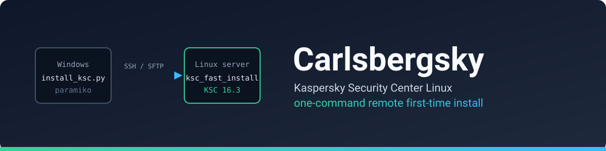
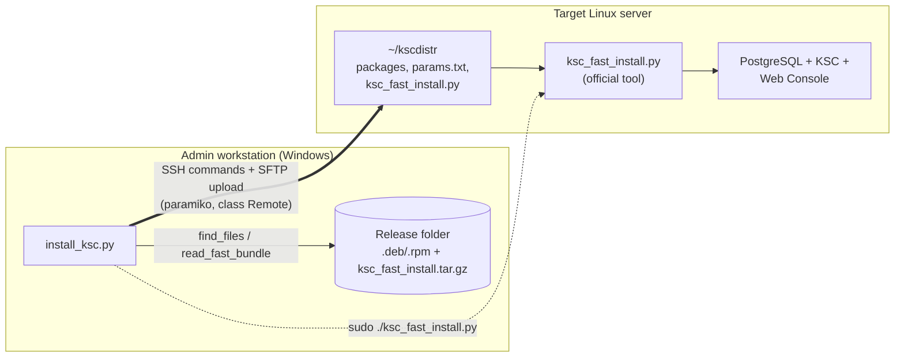
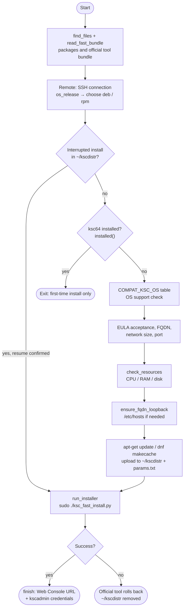

<div align="center">



**Install Kaspersky Security Center (KSC) on an empty Linux server from Windows with a single command.**

[](https://github.com/emreyigit-tasdelen/Carlsbergsky/actions/workflows/ci.yml)
[](LICENSE)


**English** · [Türkçe](README.tr.md)

[Quick start](#quick-start) · [Architecture](#architecture) · [Configuration](#configuration) · [Troubleshooting](#troubleshooting) · [Technical deep dive](docs/architecture.md)

</div>

---

## What it does

KSC Linux 16.3 ships with an official installer, `ksc_fast_install.py`. It installs the DBMS, databases, service accounts, Administration Server and Web Console. But the tool runs **on the server itself**, as root, next to the packages: you have to copy the files over, write `params.txt` by hand and check compatibility yourself.

**Carlsbergsky runs that whole job from your Windows machine:**

| By hand | With Carlsbergsky |
|---|---|
| `scp` the packages, unpack the bundle | Point it at the release folder; it finds and uploads the files |
| Look up compatibility in the docs | Checks OS and resource thresholds **from the official tool's own tables** |
| Edit `params.txt` manually | Answer a few prompts; it writes the file |
| Verify FQDN resolution yourself | Offers to add the FQDN to `/etc/hosts` (with a backup) if it does not resolve to loopback |
| Clean up after a failed run | Removes uploaded files on failure; resumes after Ctrl+C |

> The installation itself is done by **Kaspersky's official tool**. This project drives it remotely and automates the preparation around it. The installation logic was not rewritten.

## Quick start

**Prerequisites**
- Windows (or any machine that runs Python) with Python 3. Tested with Python 3.12.
- SSH access to the target server (password authentication) with a sudo-capable user.
- **One release folder** downloaded from Kaspersky, for example:

```text
16.3/
├── ksc64_16.3.0-1207_amd64.deb              # Administration Server (or .rpm)
├── ksc-web-console-16.3.13218.x86_64.deb    # Web Console (or .rpm)
└── ksc_fast_install.tar.gz                  # "KSC installation script" bundle
```

**Run**

```bash
pip install -r requirements.txt
python install_ksc.py
```

The script asks for the folder path, server IP, SSH credentials and a few install settings. Everything has a default; <kbd>Enter</kbd> is enough for most prompts.

<details>
<summary><b>Example session (shortened, addresses replaced with documentation values)</b></summary>

```text
=== Carlsbergsky 1.0.0: Kaspersky Security Center Linux remote install ===

Release folder (e.g. C:\Kaspersky\16.3): C:\Kaspersky\16.3
Server IP: 192.0.2.10
SSH port [22]:
SSH user [root]: admin
SSH password:

Server: Ubuntu 26.04.1 LTS
KSC 16.3 supported OS: ubuntu-26.04, centos-10, astra-1.8, redos-8
Have you read and do you accept these agreements? [y/N]: y
Administration Server FQDN (e.g. ksclinux.example.com) [ksc01]:
Network size S/M/L/XL [S]: S
Web Console port [8080]:

Server resources: 12 CPU, 15.1 GB RAM, 70.9 GB free on /var
'S' requirements met (6 CPU, 14 GB RAM, 70 GB disk).
FQDN check: ksc01 -> 127.0.1.1 (loopback, OK)
...
[+] Installing DBMS ...                 [+] OK
[+] Installing KSC ...                  [+] OK
[+] Installing Web Console ...          [+] OK
[+] Creating KSC user 'kscadmin' ...
[+]     User: kscadmin
[+]     Pass: ************
[+] Success

=== Installation complete ===
Web Console: https://ksc01:8080
User: kscadmin   Password: ************   <- SAVE IT, it is not shown again
```

</details>

Save the `kscadmin` password when the install finishes: **it is not shown again**. If you lose it, create a new user on the server with `sudo /opt/kaspersky/ksc64/sbin/kladduser -n <user>` (as printed by Kaspersky's own tool).

## Architecture



The script does two things: **preparation** (checks, file transfer, `params.txt`) and **execution** (running the official tool on the server and streaming its output live). Every installation decision belongs to the official tool.

### Flow



Step-by-step sequence, state transitions and design decisions: **[docs/architecture.md](docs/architecture.md)**.

### Design principles

- **Drive the official tool, don't rewrite it.** Installation logic stays with Kaspersky; when a new release ships a new tool, the script needs no code change.
- **Release and OS independent checks.** Supported OS (`COMPAT_KSC_OS`) and resource thresholds (`NETSIZE_*_REQUIRED`) are read from the official tool's source with `ast.literal_eval`; no hard-coded lists.
- **Safe defaults.** Agreements require explicit acceptance, `params.txt` is written with `600` permissions, and the `sudo` password is masked in the output.
- **Interrupted work is recoverable.** Ctrl+C does not roll back; running again resumes from the last completed step.

## Tech stack

| Component | Technology | Version | Role |
|---|---|---|---|
| Orchestration | Python 3 (standard library + paramiko) | tested on 3.12 | Flow, checks, live output |
| SSH / SFTP | [paramiko](https://www.paramiko.org/) | tested on 5.0 and 5.1 | Remote commands and file upload |
| Install engine | Kaspersky `ksc_fast_install.py` | shipped with 16.3 | DBMS, KSC, Web Console installation |
| Database | PostgreSQL (chosen by the official tool) | depends on OS | KSC and IAM databases |

## Configuration

There are no environment variables or config files; every setting is asked at runtime. <kbd>Enter</kbd> accepts the default.

| Prompt | Default | Description |
|---|---|---|
| Release folder | (none) | Folder containing the packages and `ksc_fast_install.tar.gz` (subfolders are scanned) |
| Server IP / SSH port | (none) / `22` | Target server |
| SSH user | `root` | If not root, commands run with `sudo -S` |
| FQDN | output of `hostname -f` | Written as `klfi_klserver_address`, `klfi_kliam_address`, `klfi_display_name` |
| Network size | `S` | `S`, `M`, `L`, `XL`; `klfi_netsize` |
| Web Console port | `8080` | `klfi_nwc_port` |

<details>
<summary><b>Resource thresholds (read from the official tool, 16.3 values)</b></summary>

Total requirement (KSC + DBMS + Web Console on the same server):

| Size | CPU | RAM | Free on `/var` |
|---|---|---|---|
| S | 6 | 14 GB | 70 GB |
| M | 10 | 22 GB | 340 GB |
| L | 18 | 38 GB | 490 GB |
| XL | 26 | 52 GB | 640 GB |

Kaspersky's 16.3 guide recommends higher values (for example 8 CPU and 16 GB RAM for S) plus 4-6 GB RAM and 20 GB disk for the OS. The script only checks the threshold the official tool enforces. If resources are short it offers to skip the check (**not supported** by Kaspersky; test/lab only).

</details>

<details>
<summary><b>Systems supported by the official tool (16.3)</b></summary>

| Operating system | DBMS |
|---|---|
| Ubuntu Server 26.04 LTS | PostgreSQL 18 |
| CentOS Stream 10 | PostgreSQL 18 |
| RED OS 8 | PostgreSQL 16 |
| Astra Linux SE 1.8.5 | PostgreSQL 15 |

Source: KSC Linux 16.3 guide. A real installation has only been tested on **Ubuntu 26.04**.

</details>

## Project structure

```text
.
├── install_ksc.py          # single-file tool: flow, Remote (SSH/SFTP), checks
├── requirements.txt        # paramiko
├── ruff.toml               # lint rules (used by CI)
├── README.md / README.tr.md
├── SECURITY.md
├── LICENSE                 # MIT
├── docs/
│   ├── architecture.md     # deep dive: sequence, states, decisions (+ .tr.md)
│   └── assets/banner.svg   # README header image
└── .github/
    ├── workflows/ci.yml    # ruff + py_compile on every push / PR
    └── FUNDING.yml
```

## Development

There is no test suite; CI runs lint and a syntax check:

```bash
pip install ruff
ruff check .
python -m py_compile install_ksc.py
```

Kaspersky packages (`*.deb`, `*.rpm`, `*.tar.gz`) are licensed distributions and are kept out of the repository by `.gitignore`.

## Security and limitations

- **First-time installation only.** The official tool does not run on a server with KSC installed, for upgrades or on failover clusters; the script exits if it finds KSC.
- **Password SSH only.** Key-based authentication is not supported.
- **Host keys are not verified.** paramiko `AutoAddPolicy` is used, so there is a man-in-the-middle risk on untrusted networks. Use it only on networks you trust.
- **Certificates.** Web Console and IAM (port 4444) use self-signed certificates; the browser warning is expected.
- **No system hardening.** Neither the script nor the official tool hardens the server; apply the Kaspersky Hardening Guide.
- **Tested on Ubuntu 26.04 only.** CentOS, Astra and RED OS (including the rpm path) are supported in code but not verified on a real server.

To report a vulnerability, see [SECURITY.md](SECURITY.md).

## Troubleshooting

<details>
<summary><b>Web Console <code>https://&lt;IP&gt;:8080</code> opens but the sign-in page does not</b></summary>

In KSC 16.3 sign-in is handled by the IAM service, which redirects the browser to `https://<FQDN>:4444/...`. If the client cannot resolve the FQDN, the page does not load. Fix: add a DNS A record (FQDN → server IP) or a line `<IP>  <FQDN>` to the client's `hosts` file, then open `https://<FQDN>:8080`. The FQDN must resolve to loopback **on the server** and to the real IP **on clients**.

</details>

<details>
<summary><b>"Requires more than N CPU cores / GB of free memory"</b></summary>

The server does not meet the threshold of the selected network size. Add resources or pick a smaller size (S). Memory is measured with `MemTotal`; disable dynamic memory on the hypervisor during the install.

</details>

<details>
<summary><b>The installation was interrupted</b></summary>

Run the script again and answer yes to "An interrupted installation was found"; the official tool resumes from the last completed step. To abandon it, run `cd ~/kscdistr && sudo ./ksc_fast_install.py rollback` on the server. The official tool's state and logs are in `/var/opt/kaspersky/ksc_fast_install/`.

</details>

## Support

If Carlsbergsky saved you time, you can support its development:

[](https://github.com/sponsors/emreyigit-tasdelen)
[](https://buymeacoffee.com/emreyigit.tasdelen)

## License and disclaimer

Released under the [MIT License](LICENSE). © 2026 [Emre Yiğit Taşdelen](https://github.com/emreyigit-tasdelen).

This is an independent project and is not affiliated with, endorsed by or supported by Kaspersky. "Kaspersky" and "Kaspersky Security Center" are trademarks of their respective owner. Kaspersky software is not included and is subject to its own license agreements, which you must accept during installation.
