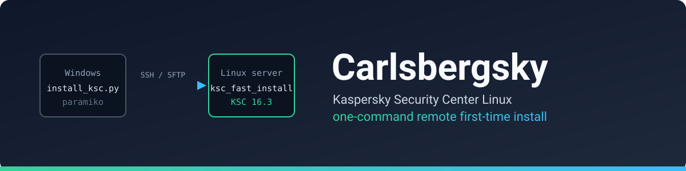
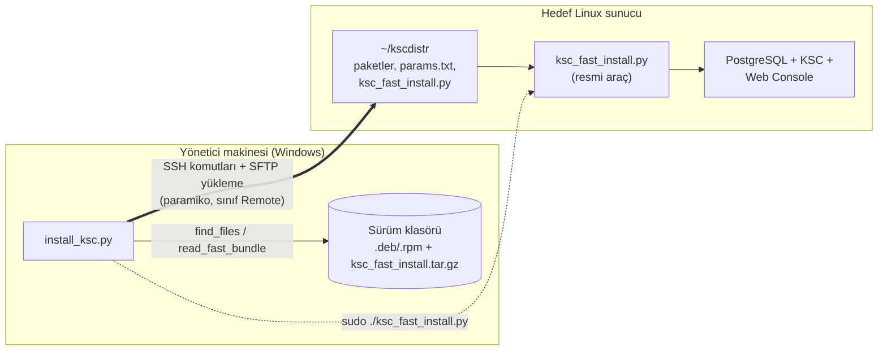
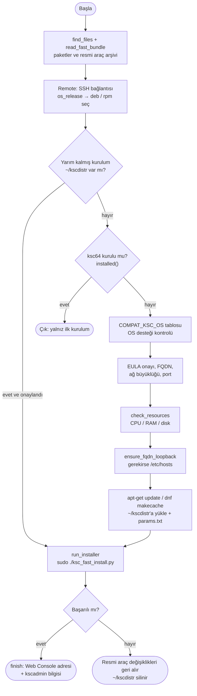

<div align="center">



**Boş bir Linux sunucuya Kaspersky Security Center'ı (KSC) Windows'tan tek komutla kur.**

[](https://github.com/emreyigit-tasdelen/Carlsbergsky/actions/workflows/ci.yml)
[](LICENSE)


[English](README.md) · **Türkçe**

[Hızlı başlangıç](#hızlı-başlangıç) · [Mimari](#mimari) · [Yapılandırma](#yapılandırma) · [Sorun giderme](#sorun-giderme) · [Derin teknik doküman](docs/architecture.tr.md)

</div>

---

## Ne işe yarar?

Kaspersky, KSC Linux 16.3 ile `ksc_fast_install.py` adında resmi bir kurulum aracı veriyor: DBMS'yi, veritabanlarını, servis hesaplarını, Administration Server'ı ve Web Console'u kurar. Ama bu araç **sunucunun içinde**, paketlerle aynı klasörde ve root olarak çalışır; dosyaları sunucuya kendin taşımalı, `params.txt`'yi elle yazmalı, uyumluluğu kendin kontrol etmelisin.

**Carlsbergsky bu işi senin Windows makinenden yürütür:**

| Elle yaparsan | Carlsbergsky ile |
|---|---|
| Paketleri `scp` ile kopyala, arşivi aç | Sürüm klasörünü gösterirsin, dosyaları kendisi bulup yükler |
| Uyumluluğu doküman tablosundan oku | OS ve kaynak eşiklerini **resmi aracın kendi tablolarından** okuyup kontrol eder |
| `params.txt`'yi elle düzenle | Sorulara cevap verirsin, dosyayı kendisi yazar |
| FQDN çözümlemesini kendin kontrol et | Loopback'e çözülmüyorsa `/etc/hosts`'a eklemeyi önerir (yedek alarak) |
| Araç hata verirse neyin kaldığına bak | Hatada yüklenen dosyaları siler; Ctrl+C'de kaldığı yerden devam eder |

> Kurulumu **Kaspersky'nin resmi aracı** yapar; bu proje onu uzaktan sürer ve çevresindeki hazırlık adımlarını otomatikleştirir. Kurulum mantığı yeniden yazılmadı.

## Hızlı başlangıç

**Önkoşullar**
- Windows (veya Python çalışan herhangi bir makine) + Python 3. Python 3.12 ile test edildi.
- Hedef sunucuya SSH erişimi (parola ile) ve sudo yetkisi olan bir kullanıcı.
- Kaspersky'den indirilmiş **tek bir sürüm klasörü**, örneğin:

```text
16.3/
├── ksc64_16.3.0-1207_amd64.deb              # Administration Server (.rpm de olabilir)
├── ksc-web-console-16.3.13218.x86_64.deb    # Web Console (.rpm de olabilir)
└── ksc_fast_install.tar.gz                  # "KSC installation script" arşivi
```

**Çalıştır**

```bash
pip install -r requirements.txt
python install_ksc.py
```

Script sırayla klasör yolunu, sunucu IP'sini, SSH bilgilerini ve birkaç kurulum ayarını sorar (arayüz İngilizcedir). Hepsinin varsayılanı vardır; çoğu soruda <kbd>Enter</kbd> yeterlidir. Evet/hayır sorularına `y` veya `e` yazılabilir.

<details>
<summary><b>Örnek oturum (kısaltılmış, adresler örnek değerlerle değiştirildi)</b></summary>

```text
=== Carlsbergsky 1.0.0: Kaspersky Security Center Linux remote install ===

Release folder (e.g. C:\Kaspersky\16.3): C:\Kaspersky\16.3
Server IP: 192.0.2.10
SSH port [22]:
SSH user [root]: admin
SSH password:

Server: Ubuntu 26.04.1 LTS
KSC 16.3 supported OS: ubuntu-26.04, centos-10, astra-1.8, redos-8
Have you read and do you accept these agreements? [y/N]: y
Administration Server FQDN (e.g. ksclinux.example.com) [ksc01]:
Network size S/M/L/XL [S]: S
Web Console port [8080]:

Server resources: 12 CPU, 15.1 GB RAM, 70.9 GB free on /var
'S' requirements met (6 CPU, 14 GB RAM, 70 GB disk).
FQDN check: ksc01 -> 127.0.1.1 (loopback, OK)
...
[+] Installing DBMS ...                 [+] OK
[+] Installing KSC ...                  [+] OK
[+] Installing Web Console ...          [+] OK
[+] Creating KSC user 'kscadmin' ...
[+]     User: kscadmin
[+]     Pass: ************
[+] Success

=== Installation complete ===
Web Console: https://ksc01:8080
User: kscadmin   Password: ************   <- SAVE IT, it is not shown again
```

</details>

Kurulum bitince `kscadmin` şifresini kaydet: **bir daha gösterilmez**. Kaybedersen sunucuda `sudo /opt/kaspersky/ksc64/sbin/kladduser -n <kullanici>` ile yeni kullanıcı açılır (Kaspersky'nin kendi çıktısındaki yönerge).

## Mimari



Script iki iş yapar: **hazırlık** (kontroller, dosya aktarımı, `params.txt`) ve **yürütme** (resmi aracı sunucuda çalıştırıp çıktısını canlı akıtmak). Tüm kurulum kararları resmi araca aittir.

### Akış



Adım adım zaman çizelgesi, durum geçişleri ve tasarım kararları: **[docs/architecture.tr.md](docs/architecture.tr.md)**.

### Tasarım ilkeleri

- **Resmi aracı yeniden yazma, sür.** Kurulum mantığı Kaspersky'de kalır; sürüm değişince araç da değişir, script'te kod değiştirmen gerekmez.
- **Sürüm ve OS bağımsız kontrol.** Desteklenen OS (`COMPAT_KSC_OS`) ve kaynak eşikleri (`NETSIZE_*_REQUIRED`) resmi aracın kaynak kodundan `ast.literal_eval` ile okunur; script içinde sabit liste tutulmaz.
- **Güvenli varsayılan.** Sözleşmeler açık onayla kabul edilir, `params.txt` `600` izinle yazılır, `sudo` parolası çıktıda maskelenir.
- **Yarım kalan iş kurtarılabilir.** Ctrl+C geri almaz; tekrar çalıştırınca resmi araç kaldığı adımdan devam eder.

## Teknoloji yığını

| Bileşen | Teknoloji | Sürüm | Rolü |
|---|---|---|---|
| Orkestrasyon | Python 3 (standart kütüphane + paramiko) | 3.12'de test edildi | Akış, kontroller, canlı çıktı |
| SSH / SFTP | [paramiko](https://www.paramiko.org/) | 5.0 ve 5.1'de test edildi | Uzak komut ve dosya yükleme |
| Kurulum motoru | Kaspersky `ksc_fast_install.py` | 16.3 ile gelen | DBMS, KSC, Web Console kurulumu |
| Veritabanı | PostgreSQL (resmi araç seçer) | OS'e göre | KSC ve IAM veritabanları |

## Yapılandırma

Ortam değişkeni veya yapılandırma dosyası yoktur; tüm ayarlar çalışırken sorulur. <kbd>Enter</kbd> varsayılanı kabul eder.

| Soru | Varsayılan | Açıklama |
|---|---|---|
| Release folder | (yok) | Paketlerin ve `ksc_fast_install.tar.gz`'nin bulunduğu klasör (alt klasörler taranır) |
| Server IP / SSH port | (yok) / `22` | Hedef sunucu |
| SSH user | `root` | root değilse komutlar `sudo -S` ile çalışır |
| FQDN | `hostname -f` çıktısı | `klfi_klserver_address`, `klfi_kliam_address`, `klfi_display_name` olarak yazılır |
| Network size | `S` | `S`, `M`, `L`, `XL`; `klfi_netsize` |
| Web Console port | `8080` | `klfi_nwc_port` |

<details>
<summary><b>Kaynak eşikleri (resmi araçtan okunur, 16.3 değerleri)</b></summary>

Toplam gereksinim (KSC + DBMS + Web Console aynı sunucuda):

| Boyut | CPU | RAM | `/var` boş disk |
|---|---|---|---|
| S | 6 | 14 GB | 70 GB |
| M | 10 | 22 GB | 340 GB |
| L | 18 | 38 GB | 490 GB |
| XL | 26 | 52 GB | 640 GB |

Kaspersky'nin 16.3 kılavuzu daha yüksek değerler önerir (örneğin S için 8 CPU, 16 GB RAM) ve işletim sistemi için ek 4-6 GB RAM, 20 GB disk ister. Script yalnız resmi aracın zorladığı eşiği kontrol eder. Yetersizse "kontrolü atla" seçeneği sunar (Kaspersky tarafından **desteklenmez**, yalnız test/lab).

</details>

<details>
<summary><b>Resmi aracın desteklediği sistemler (16.3)</b></summary>

| İşletim sistemi | DBMS |
|---|---|
| Ubuntu Server 26.04 LTS | PostgreSQL 18 |
| CentOS Stream 10 | PostgreSQL 18 |
| RED OS 8 | PostgreSQL 16 |
| Astra Linux SE 1.8.5 | PostgreSQL 15 |

Kaynak: KSC Linux 16.3 kılavuzu. Bu projede yalnız **Ubuntu 26.04** üzerinde gerçek kurulum denendi.

</details>

## Proje yapısı

```text
.
├── install_ksc.py          # tek dosyalık araç: akış, Remote (SSH/SFTP), kontroller
├── requirements.txt        # paramiko
├── ruff.toml               # lint kuralları (CI kullanır)
├── README.md / README.tr.md
├── SECURITY.md
├── LICENSE                 # MIT
├── docs/
│   ├── architecture.md     # derin teknik doküman (+ .tr.md)
│   └── assets/banner.svg   # README başlık görseli
└── .github/
    ├── workflows/ci.yml    # her push / PR'da ruff + py_compile
    └── FUNDING.yml
```

## Geliştirme

Test paketi yoktur; CI lint ve sözdizimi kontrolü yapar:

```bash
pip install ruff
ruff check .
python -m py_compile install_ksc.py
```

Kaspersky paketleri (`*.deb`, `*.rpm`, `*.tar.gz`) lisanslı dağıtımdır ve `.gitignore` ile repo dışında tutulur.

## Güvenlik ve sınırlar

- **Yalnız ilk kurulum.** Resmi araç KSC kurulu sunucuda, güncellemede ve failover cluster'da çalışmaz; script de kurulu KSC görürse çıkar.
- **Yalnız parola ile SSH.** Anahtar tabanlı kimlik doğrulama yok.
- **Sunucu anahtarı doğrulanmaz.** paramiko `AutoAddPolicy` kullanılır; güvenilmeyen ağlarda ortadaki adam riski vardır. Yalnız güvendiğin ağda kullan.
- **Sertifikalar.** Web Console ve IAM (port 4444) kendinden imzalı sertifika kullanır; tarayıcı uyarısı normaldir.
- **Sistem sıkılaştırması yapılmaz.** Resmi araç da yapmaz; Kaspersky Hardening Guide'ı uygula.
- **Yalnız Ubuntu 26.04 üzerinde denendi.** CentOS, Astra ve RED OS (rpm yolu dahil) kod içinde desteklenir ama gerçek sunucuda doğrulanmadı.

Güvenlik açığı bildirmek için: [SECURITY.md](SECURITY.md).

## Sorun giderme

<details>
<summary><b>Web Console <code>https://&lt;IP&gt;:8080</code> açılıyor ama giriş sayfası açılmıyor</b></summary>

KSC 16.3'te girişi IAM servisi yapar ve tarayıcıyı `https://<FQDN>:4444/...` adresine yönlendirir. İstemci makine FQDN'i çözemezse sayfa açılmaz. Çözüm: DNS'e FQDN → sunucu IP'si A kaydı ekle ya da istemcinin `hosts` dosyasına `<IP>  <FQDN>` yaz, sonra `https://<FQDN>:8080` adresini aç. FQDN, sunucunun **kendisinde** loopback'e, **istemcilerde** gerçek IP'ye çözülmelidir.

</details>

<details>
<summary><b>"Requires more than N CPU cores / GB of free memory"</b></summary>

Sunucu seçilen ağ büyüklüğünün eşiğini karşılamıyor. Kaynakları artır ya da daha küçük boyut seç (S). Bellek `MemTotal` ile ölçülür; hipervizörde dinamik belleği kurulum süresince kapat.

</details>

<details>
<summary><b>Kurulum yarıda kesildi</b></summary>

Script'i yeniden çalıştır; "An interrupted installation was found" sorusuna evet de, resmi araç kaldığı adımdan devam eder. Vazgeçmek için sunucuda `cd ~/kscdistr && sudo ./ksc_fast_install.py rollback` çalıştır. Resmi aracın durum ve logları `/var/opt/kaspersky/ksc_fast_install/` altındadır.

</details>

## Destek

Carlsbergsky işini kolaylaştırdıysa geliştirilmesine destek olabilirsin:

[](https://github.com/sponsors/emreyigit-tasdelen)
[](https://buymeacoffee.com/emreyigit.tasdelen)

## Lisans ve sorumluluk reddi

[MIT Lisansı](LICENSE) ile yayımlanmıştır. © 2026 [Emre Yiğit Taşdelen](https://github.com/emreyigit-tasdelen).

Bu bağımsız bir projedir; Kaspersky ile bağlantılı değildir, Kaspersky tarafından onaylanmamış ve desteklenmemektedir. "Kaspersky" ve "Kaspersky Security Center" ilgili sahibinin ticari markalarıdır. Kaspersky yazılımı bu repoya dahil değildir ve kurulum sırasında kabul etmen gereken kendi lisans sözleşmelerine tabidir.
