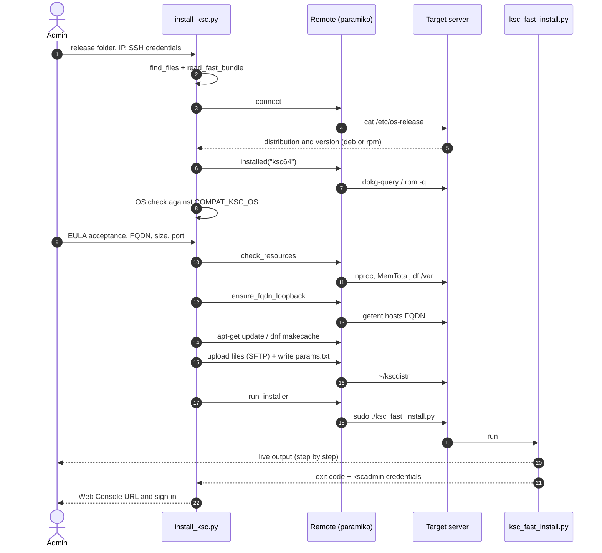
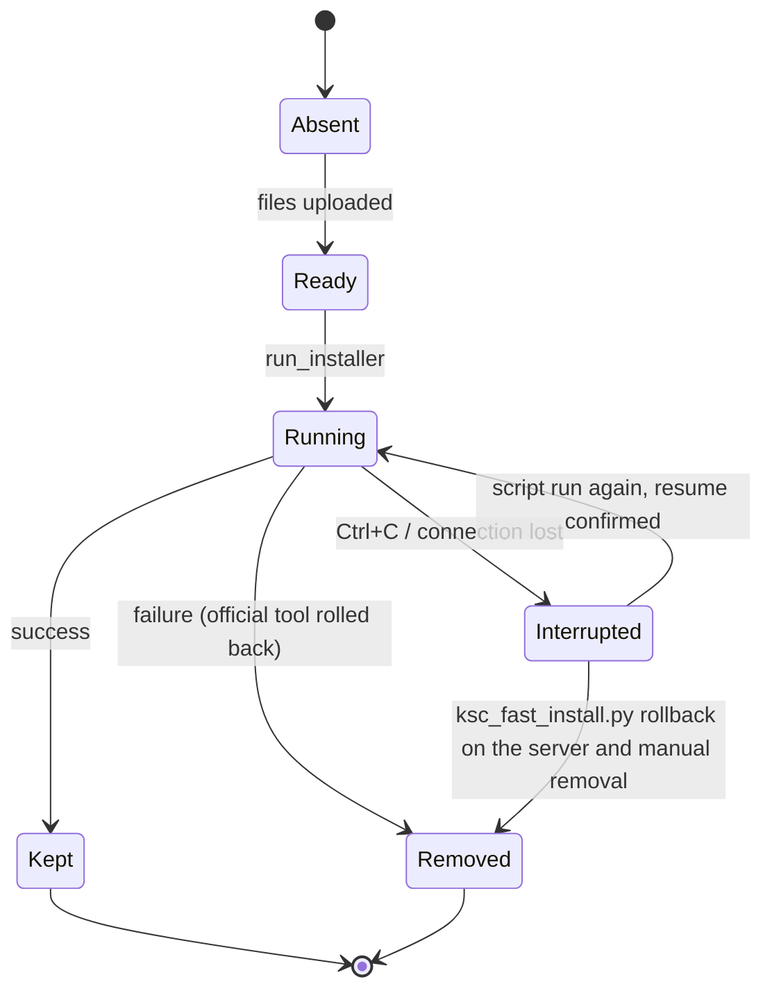

# Architecture

[← README](../README.md) · **English** · [Türkçe](architecture.tr.md)

Carlsbergsky is a single-file Python tool (`install_ksc.py`). It has no persistent data model, database or server component, so there is no ER diagram. State lives only in `~/kscdistr` on the target server and in the official tool's `/var/opt/kaspersky/ksc_fast_install/` folder.

## Code components

| Component (`install_ksc.py`) | Responsibility |
|---|---|
| `find_files`, `read_fast_bundle` | Scans the release folder; finds the `ksc64*` and `ksc-web-console*` packages (deb/rpm) and the `ksc_fast_install` bundle, unpacks the bundle in memory |
| `literal_table`, `ksc_version` | Reads constant tables (`COMPAT_KSC_OS`, `NETSIZE_CPU/RAM/DISK_REQUIRED`) from the official tool's source with `ast.literal_eval`; extracts the version from the package name |
| `Remote` | SSH + SFTP via paramiko: `run` (live output, sudo password masking), `out`, `must`, `upload`, `write_bytes`, `os_release`, `installed` |
| `connect` | Reports connection and authentication errors with a clear message |
| `check_resources` | Compares the server's `nproc`, `MemTotal` and free space on `/var` with the official thresholds |
| `ensure_fqdn_loopback` | Verifies the FQDN resolves to loopback on the server; adds it to `/etc/hosts` if needed |
| `run_installer` | Runs `./ksc_fast_install.py` inside `~/kscdistr` |
| `main`, `finish` | Flow, confirmations, cleanup, result summary |

## Sequence

## Working folder lifecycle

`~/kscdistr` (on the server) ends in one of three states:

In code: `cleanup_on_error` becomes `True` only after the upload starts; it is reset to `False` on success and stays `False` on `KeyboardInterrupt`. The `finally` block removes the folder when `cleanup_on_error` is set.

## Design decisions

| Decision | Why |
|---|---|
| Drive the official `ksc_fast_install.py` instead of rewriting the installation | DBMS, account and service setup changes between releases; Kaspersky's tool already handles it and rolls back its own changes on failure |
| Compatibility and resource thresholds are read from the official tool's source | A new release folder needs no code change; a hand-maintained list would go stale and give wrong answers |
| No upgrade mode | The official tool runs only on servers without KSC (per the guide). The scope is intentionally narrow |
| Packages are never committed | Kaspersky's licensed distribution, hundreds of MB in size; excluded by `.gitignore` |
| Skipping the resource check patches only the uploaded copy | The local file is untouched; if the call line is not found the script stops with a warning instead of silently patching the wrong place |
| `sudo -S` + PTY, password masked in output | The PTY echoes the password back; the first line is swallowed and any occurrence is replaced with `******` |
| `params.txt` is `chmod 600` | EULA and address details are not readable by other users |

## Known limitations

See README → [Security and limitations](../README.md#security-and-limitations).

---

© 2026 Emre Yiğit Taşdelen · MIT License
