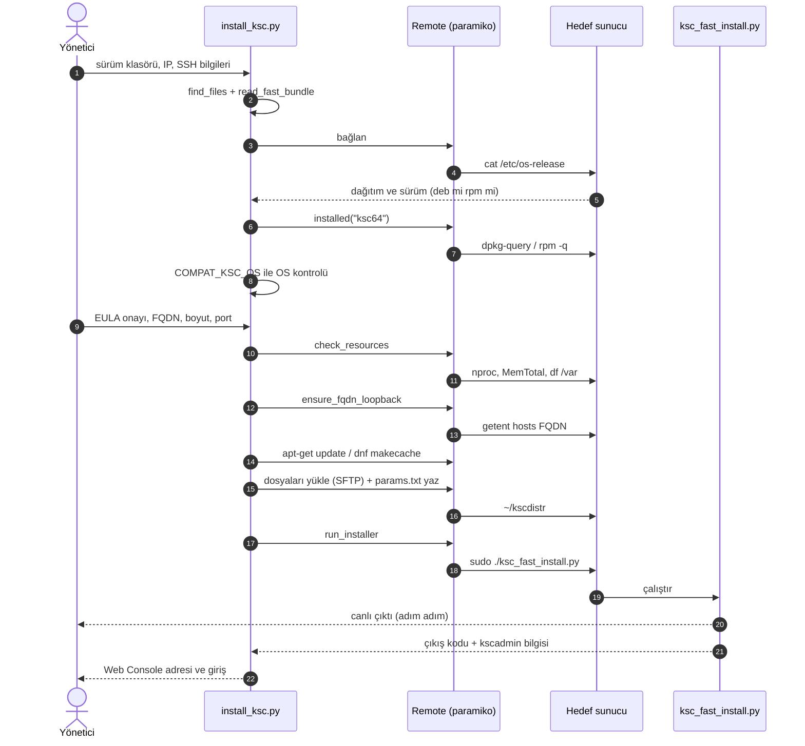
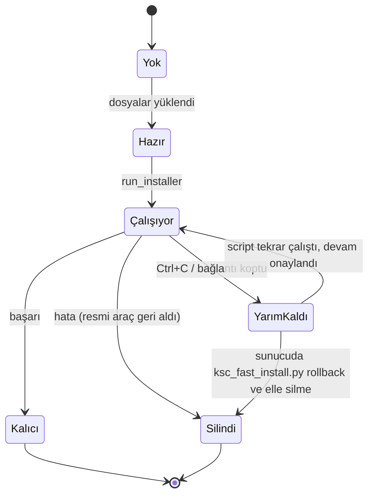

# Mimari

[← README](../README.tr.md) · [English](architecture.md) · **Türkçe**

Carlsbergsky tek dosyalık bir Python aracıdır (`install_ksc.py`). Kalıcı veri modeli, veritabanı veya sunucu bileşeni yoktur; bu nedenle ER diyagramı içermez. Durum yalnızca hedef sunucudaki `~/kscdistr` klasöründe ve resmi aracın `/var/opt/kaspersky/ksc_fast_install/` klasöründe tutulur.

## Kod bileşenleri

| Bileşen (`install_ksc.py`) | Sorumluluk |
|---|---|
| `find_files`, `read_fast_bundle` | Sürüm klasörünü tarar; `ksc64*`, `ksc-web-console*` paketlerini (deb/rpm) ve `ksc_fast_install` arşivini bulur, arşivi bellekte açar |
| `literal_table`, `ksc_version` | Resmi aracın kaynak kodundan sabit tabloları (`COMPAT_KSC_OS`, `NETSIZE_CPU/RAM/DISK_REQUIRED`) `ast.literal_eval` ile okur; paket adından sürümü çıkarır |
| `Remote` | paramiko ile SSH + SFTP: `run` (canlı çıktı, sudo parolası maskeleme), `out`, `must`, `upload`, `write_bytes`, `os_release`, `installed` |
| `check_resources` | Sunucunun `nproc`, `MemTotal`, `/var` boş alanını resmi eşiklerle karşılaştırır |
| `ensure_fqdn_loopback` | FQDN'in sunucuda loopback'e çözüldüğünü doğrular; gerekirse `/etc/hosts`'a ekler |
| `run_installer` | `~/kscdistr` içinde `./ksc_fast_install.py` çalıştırır |
| `connect` | Bağlantı ve kimlik doğrulama hatalarını anlaşılır mesajla bildirir |
| `main`, `finish` | Akış, onaylar, temizlik, sonuç özeti |

## Zaman çizelgesi

## Çalışma klasörünün yaşam döngüsü

`~/kscdistr` (sunucuda) üç sonla biter:

Koddaki karşılığı: `cleanup_on_error` yalnızca yükleme başladıktan sonra `True` olur; başarıda `False`'a çekilir, `KeyboardInterrupt`'ta `False` kalır. `finally` bloğu `cleanup_on_error` ise klasörü siler.

## Tasarım kararları

| Karar | Neden |
|---|---|
| Resmi `ksc_fast_install.py` sürülür, kurulum yeniden yazılmaz | DBMS, hesap ve servis kurulumu sürümle değişir; Kaspersky'nin aracı bunu zaten yönetir ve hatada kendi değişikliklerini geri alır |
| Uyumluluk ve kaynak eşikleri resmi aracın kaynağından okunur | Yeni sürüm klasörü verildiğinde script'te kod değişmez; kendi listemiz eskiyip yanlış sonuç vermez |
| Güncelleme modu yok | Resmi araç yalnız KSC kurulu olmayan sunucuda çalışır (kılavuz). Kapsam bilerek dar tutuldu |
| Paketler repoya girmez | Kaspersky lisanslı dağıtımı; boyutları yüzlerce MB. `.gitignore` ile dışarıda |
| Kaynak kontrolünü atlama yalnız sunucuya yüklenen kopyada yamalanır | Yerel dosya değişmez; yama, çağrı satırı bulunamazsa uyarıyla durur (araç yapısı değişmişse sessizce yanlış yama yapmaz) |
| `sudo -S` + PTY, parola çıktıdan maskelenir | PTY gönderilen parolayı geri yansıtır; ilk satır yutulur ve parola `******` ile değiştirilir |
| `params.txt` `chmod 600` | EULA ve adres bilgisi başkalarınca okunmasın |

## Bilinen sınırlar

Bkz. README → [Güvenlik ve sınırlar](../README.tr.md#güvenlik-ve-sınırlar).

---

© 2026 Emre Yiğit Taşdelen · MIT Lisansı
